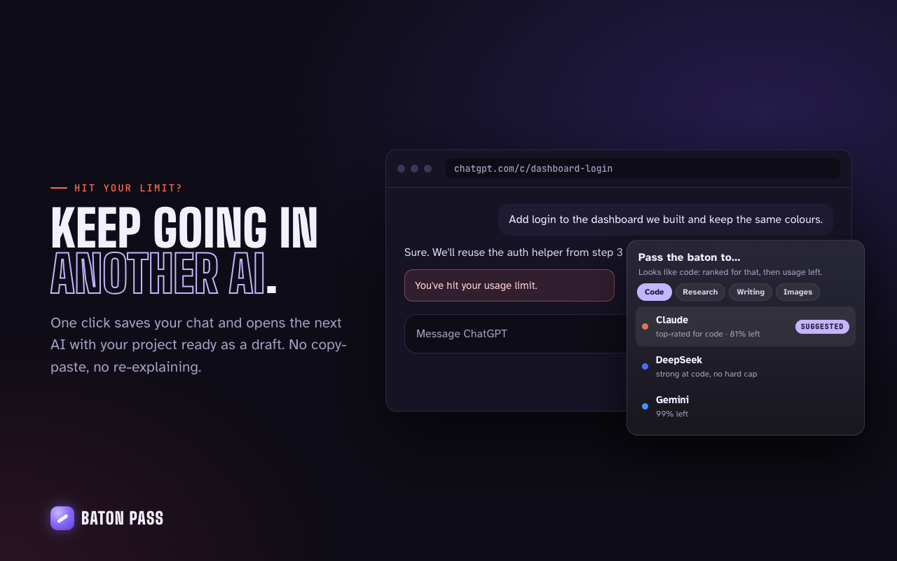

<p align="center">
  
</p>

<h1 align="center">Baton Pass</h1>

<p align="center">
  <b>Continue any AI chat in another AI, with nothing lost.</b><br>
  Save your project, see every AI's usage limits, and pass the whole chat to another AI as a draft you send yourself.
</p>

<p align="center">
  <a href="https://github.com/Oscar-man-shrestha/handoff/actions/workflows/ci.yml"></a>
  
  
  <a href="LICENSE"></a>
</p>

<p align="center">
  <a href="https://oscar-man-shrestha.github.io/handoff/">Website</a> ·
  <a href="docs/REPORT.md">Project report</a> ·
  <a href="PRIVACY.md">Privacy</a> ·
  <a href="CHANGELOG.md">Changelog</a>
</p>

<p align="center">
  
</p>

---

## Why

Free AI chats run out mid-project, and long chats quietly get worse. Copying a conversation into another AI by hand loses the first messages, the decisions, what you already rejected and the exact file names. Baton carries all of it across, and checks the next AI picked it up.

Works on **ChatGPT · Claude · Gemini · DeepSeek · Grok · Perplexity** in Chrome, Edge, Brave, Opera, Vivaldi and Arc.

## Features

- **One-click pass.** A glowing button by the chat box opens the AI you pick with your project typed in. **You press Send**; Baton never sends anything.
- **Nothing lost.** Reads the whole chat as the service stores it (not just what's on screen), keeps exact names and figures word for word, attaches the full chat as a file when it's long, and re-attaches your uploaded files.
- **Checked on arrival.** After the next AI's first reply, Baton checks it kept your rules, didn't bring back what you turned down, and took up your latest request, and offers a one-click correction if not.
- **Usage limits in one place.** What each AI has left and when it resets, from the figures the service itself reports, with a rescue card when you hit a limit and a tip when a chat gets too long.
- **The right next AI.** Suggestions ranked for your task by a small model that runs on your device.
- **Batons.** Save chats or selected parts, organise them in folders, pass them later. Keyboard shortcuts and a side panel included.
- **Private.** Chats stay in your browser. No account needed, no analytics, never reads cookies or passwords.

## Results

| | |
|---|---|
| Must-keep facts that reach the next AI (offline benchmark, 6 chats) | **100%** (1.0: 80%) |
| Real ChatGPT and Claude replies to Baton handoffs that continued the work | **12 / 12** (11 pass the automatic scorer) |
| Tests | 328 passing |

Method and details: [docs/REPORT.md §9](docs/REPORT.md#9-quality-and-evaluation) and [evaluation/README.md](evaluation/README.md).

## Install

**From the Chrome Web Store:** coming soon.

**From source:**

```bash
git clone https://github.com/Oscar-man-shrestha/handoff.git
```

```bash
cd handoff && npm install && npm run build
```

Then open `chrome://extensions` (or `edge://extensions`), turn on **Developer mode**, click **Load unpacked** and choose the `.output/chrome-mv3` folder.

## How to use

1. Chat on any of the six AIs as usual.
2. When you hit a limit or want another AI, click the glowing **Baton** button by the chat box (or press **⌘⇧U** / **Ctrl+Shift+U**).
3. Pick an AI. It opens with your project as a draft. Read it, add anything, press **Send**.

More: **⌘⇧K** keeps the chat as a baton, **⌘⇧X** saves the selected part, **⌘⇧E** opens Baton. The full guide opens from **?** in Baton.

## Development

```bash
npm run dev          # browser with Baton loaded, reloads on change
npm test             # 328 tests (Vitest)
npm run typecheck    # TypeScript
npm run eval:handoff # handoff fidelity benchmark
npm run zip          # store package in .output/
```

Architecture, every pipeline with diagrams, research and results: **[docs/REPORT.md](docs/REPORT.md)**. Contributing: [CONTRIBUTING.md](CONTRIBUTING.md). Publishing to the stores: [docs/PUBLISHING.md](docs/PUBLISHING.md).

Built with TypeScript, [WXT](https://wxt.dev), [ONNX Runtime Web](https://onnxruntime.ai) running [all-MiniLM-L6-v2](https://huggingface.co/sentence-transformers/all-MiniLM-L6-v2) on device, and [Supabase](https://supabase.com) for the optional backup.

## Privacy

Baton works only on the six AI sites, keeps your chats in your browser, and sends data only when you act: a draft to the AI you choose, an optional backup, or feedback. Full policy: [PRIVACY.md](PRIVACY.md). Security issues: [SECURITY.md](SECURITY.md).

## License

[MIT](LICENSE) © 2026 Oscar Man Shrestha. Third-party components: [THIRD_PARTY_NOTICES.md](THIRD_PARTY_NOTICES.md).

Baton Pass is independent and not affiliated with or endorsed by OpenAI, Anthropic, Google, DeepSeek, xAI or Perplexity. ChatGPT, Claude, Gemini, DeepSeek, Grok and Perplexity are trademarks of their owners.
