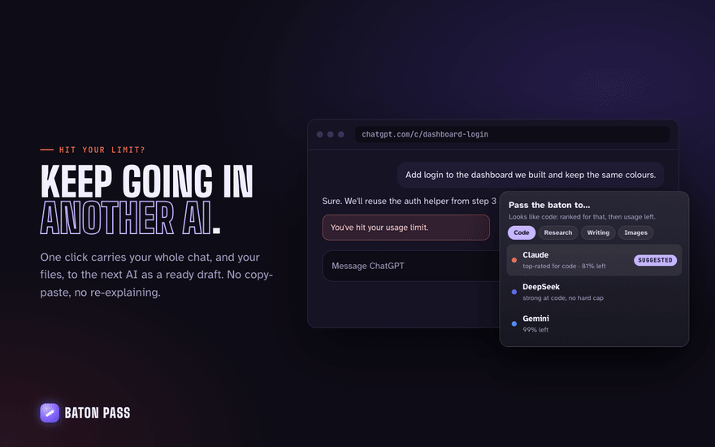
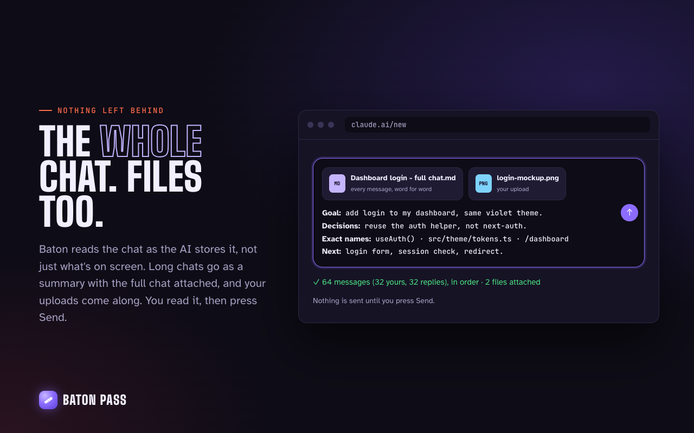
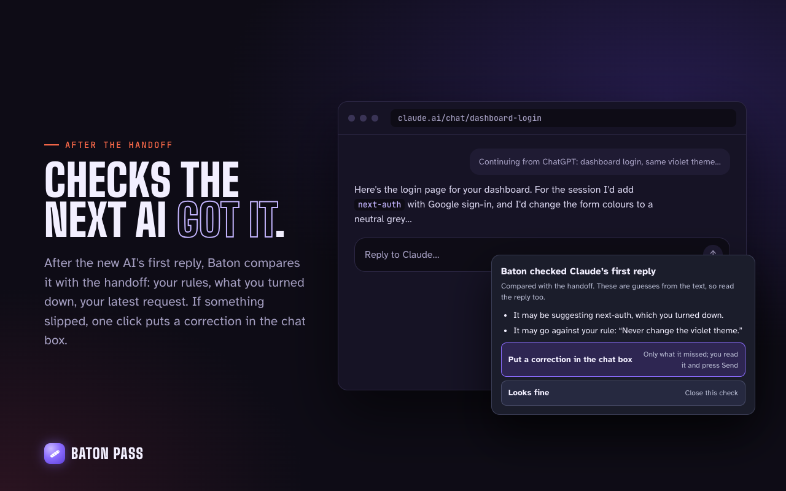
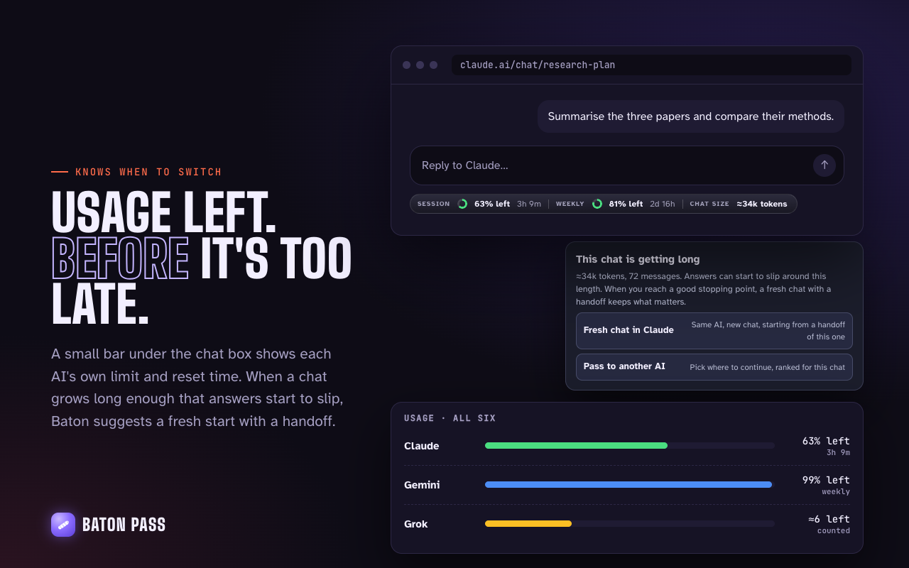
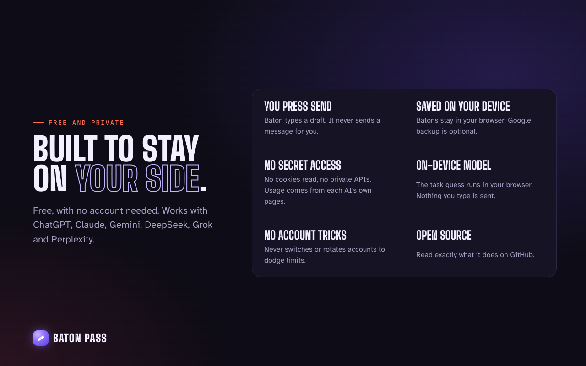

<p align="center">
  
</p>

<h1 align="center">Baton Pass</h1>

<p align="center">
  <b>Your AI ran out mid-project? Keep going in another one, with nothing lost.</b><br>
  One click carries your whole chat, your files and your decisions to ChatGPT, Claude, Gemini, DeepSeek, Grok or Perplexity.<br>
  Then it checks the next AI actually picked it up.
</p>

<p align="center">
  <a href="https://github.com/Oscar-man-shrestha/Baton/actions/workflows/ci.yml"></a>
  
  
  
  <a href="LICENSE"></a>
</p>

<p align="center">
  <a href="https://github.com/Oscar-man-shrestha/Baton/releases/tag/v1.1.0-beta"><b>Download the beta</b></a> ·
  <a href="https://oscar-man-shrestha.github.io/Baton/">Website</a> ·
  <a href="docs/TESTING.md">Tester guide</a> ·
  <a href="docs/REPORT.md">Project report</a> ·
  <a href="PRIVACY.md">Privacy</a> ·
  <a href="CHANGELOG.md">Changelog</a>
</p>

<p align="center">
  
</p>

---

## The problem

Free AI chats run out in the middle of the work, and long chats quietly get worse. Starting over in another AI means copying the conversation by hand, and something always gets lost: the first messages, the decisions, what you already turned down, the exact file names. The new AI then confidently suggests the thing you rejected an hour ago.

**Baton Pass moves the whole project in one click, and checks it arrived intact.**

## How it works

1. **Chat as usual** on any of the six AIs. A glowing Baton button sits next to the chat box, and a small bar shows how much you have left.
2. **Click the Baton button** (or press <kbd>⌘</kbd><kbd>⇧</kbd><kbd>U</kbd> / <kbd>Ctrl</kbd><kbd>Shift</kbd><kbd>U</kbd>) and pick the next AI. Baton suggests the best one for your task and how much room it has.
3. **Read the draft and press Send.** The new AI opens with your whole project typed in and your files attached. Baton never sends anything for you.
4. **Baton checks the first reply.** If the new AI ignored a rule, brought back something you rejected, or changed a number you settled, one click puts a correction in the chat box.

## What makes it different

<table>
<tr>
<td width="50%" valign="top">

### Nothing lost
Reads the whole chat **as the AI stores it**, not just what's on screen. Long chats that the page only half shows come through complete, every part of every reply included. A capture check tells you what it got: *“64 messages (32 yours, 32 replies), in order.”*

</td>
<td width="50%" valign="top">

### Your files come too
Your uploads are re-attached in the next AI, along with **what the AI made for you**: Claude's output files in their real final state, ChatGPT writing blocks. A long chat goes as a summary with the complete chat attached as a file.

</td>
</tr>
<tr>
<td valign="top">

### Checked on arrival
After the new AI's first reply, Baton compares it with the handoff: your rules, what you turned down, your latest request, the numbers you settled. *“It may have a number wrong: it says ‘three nights in Takayama’; the chat settled on 2 nights.”*

</td>
<td valign="top">

### Usage on every AI
How much each AI has left and when it resets, **from the figures the service itself reports**: ChatGPT's allowances, Claude's session and week, Gemini's quota, Grok per model, Perplexity's Pro searches. A rescue card appears when you hit a limit, and a tip when a chat gets long enough that answers slip.

</td>
</tr>
<tr>
<td valign="top">

### The right next AI
Suggestions ranked for your task (code, research, writing, maths, images) and by how much room each AI has, using a small model that runs **on your device**.

</td>
<td valign="top">

### Private by design
Your chats stay in your browser. No account, no analytics, no server in between. Baton reads chats only on the six AI sites, with the sign-in you already have.

</td>
</tr>
</table>

### Compared with copy-paste and typical handoff tools

| | Copy-paste | Typical handoff tools | **Baton Pass** |
|---|:---:|:---:|:---:|
| Whole chat, even what the page doesn't show | ✗ | some sites | **all six sites** |
| Exact names, figures and decisions kept word for word | ✗ | rarely | **✓** |
| Files you uploaded and files the AI made | ✗ | rarely | **✓** |
| Any length (summary plus the full chat as a file) | ✗ | often cut | **✓** |
| Checks the next AI's first reply, offers a correction | ✗ | ✗ | **✓** |
| Real usage left on every AI | ✗ | limit notice only | **✓** |
| Nothing sent to a server | ✓ | often not | **✓** |
| You always press Send yourself | ✓ | some auto-send | **✓** |

## Proven, not promised

| | |
|---|---|
| Must-keep facts that reach the next AI (offline benchmark, 6 chats) | **100%** (version 1.0: 80%) |
| Real ChatGPT and Claude replies to Baton handoffs that continued the work | **12 / 12** |
| Real slips caught by the reply check on those replies | **1 of 1**, with no false alarms |
| Automated tests | **349** passing |

How it was measured: [project report §9](docs/REPORT.md#9-quality-and-evaluation) and [evaluation/README.md](evaluation/README.md).

## Screenshots

<p align="center">
  
  
</p>
<p align="center">
  
  
</p>

## Install

**Chrome Web Store:** coming soon.

**Beta (Chrome, Brave, Edge, Opera, Vivaldi or Arc on a computer):**

1. Download [`handoff-extension-1.1.0-chrome.zip`](https://github.com/Oscar-man-shrestha/Baton/releases/download/v1.1.0-beta/handoff-extension-1.1.0-chrome.zip) and unzip it into a folder you'll keep.
2. Open `chrome://extensions` (or `brave://extensions`, `edge://extensions`) and turn on **Developer mode**.
3. Click **Load unpacked**, choose the unzipped folder, and pin Baton from the puzzle-piece icon.

Testing it for us? The [tester guide](docs/TESTING.md) lists what to try and how to report.

**From source:**

```bash
git clone https://github.com/Oscar-man-shrestha/Baton.git
```

```bash
cd Baton && npm install && npm run build
```

Then **Load unpacked** the `.output/chrome-mv3` folder as above.

## Keyboard shortcuts

| Action | Mac | Windows / Linux |
|---|---|---|
| Pass this chat to another AI | <kbd>⌘</kbd><kbd>⇧</kbd><kbd>U</kbd> | <kbd>Ctrl</kbd><kbd>Shift</kbd><kbd>U</kbd> |
| Keep this chat as a baton | <kbd>⌘</kbd><kbd>⇧</kbd><kbd>K</kbd> | <kbd>Ctrl</kbd><kbd>Shift</kbd><kbd>K</kbd> |
| Save the selected part as a baton | <kbd>⌘</kbd><kbd>⇧</kbd><kbd>X</kbd> | <kbd>Ctrl</kbd><kbd>Shift</kbd><kbd>X</kbd> |
| Open Baton | <kbd>⌘</kbd><kbd>⇧</kbd><kbd>E</kbd> | <kbd>Ctrl</kbd><kbd>Shift</kbd><kbd>E</kbd> |

Also available without a default key (set one in your browser's extension shortcuts): **Have this AI write the handoff** and **Open Baton in the side panel**.

## Privacy in one minute

- **You press Send.** Baton types a draft and attaches files; it never sends a message for you.
- **Your chats stay in your browser.** Batons, settings and usage readings are saved on your device. Google backup is optional and off by default.
- **Only the six AI sites.** Baton reads chats and usage there with the sign-in you already have. It never reads passwords or cookies, and the short-lived session tokens a site's own page uses are used only for that one request and never stored.
- **No analytics.** Feedback is sent only when you write it.

Full policy: [PRIVACY.md](PRIVACY.md) · Security reports: [SECURITY.md](SECURITY.md)

## FAQ

<details>
<summary><b>Does Baton send my messages or read other sites?</b></summary>

No. It only types a draft into the AI you choose, and you press Send. It works only on chatgpt.com, claude.ai, gemini.google.com, chat.deepseek.com, grok.com and perplexity.ai.
</details>

<details>
<summary><b>Is it free? Do I need an account?</b></summary>

Free and open source, with no account. The optional Google backup is the only thing that signs in, and you can ignore it.
</details>

<details>
<summary><b>What if my chat is very long?</b></summary>

Any length goes. If the whole chat fits the next AI's chat box (up to 100,000+ characters on most), it's typed in whole, with the key points first and your latest request repeated at the end. If not, a summary is typed and the complete chat is attached as a file.
</details>

<details>
<summary><b>Why does it need access to six websites?</b></summary>

To read the chat you pass and each AI's usage figures, and to type the draft into the next AI's chat box. Every permission is explained in [PRIVACY.md](PRIVACY.md#permissions).
</details>

<details>
<summary><b>What happens when an AI site changes its design?</b></summary>

Baton reads each chat as the service stores it, so most page changes don't affect it; if that fails, it falls back to reading the page. When a site change does break something, the fix ships as an update.
</details>

## For developers

```bash
npm run dev          # browser with Baton loaded, reloads on change
npm test             # 349 tests (Vitest)
npm run typecheck    # TypeScript
npm run eval:handoff # handoff fidelity benchmark
npm run eval         # score live replies from real AIs
npm run zip          # store package in .output/
```

The full story (research, architecture, every pipeline with diagrams, evaluation and results) is in the **[project report](docs/REPORT.md)**. Contributing: [CONTRIBUTING.md](CONTRIBUTING.md) · [Code of conduct](CODE_OF_CONDUCT.md). Publishing: [docs/PUBLISHING.md](docs/PUBLISHING.md).

Built with TypeScript, [WXT](https://wxt.dev), [ONNX Runtime Web](https://onnxruntime.ai) running [all-MiniLM-L6-v2](https://huggingface.co/sentence-transformers/all-MiniLM-L6-v2) on your device, and [Supabase](https://supabase.com) for the optional backup.

## License

[MIT](LICENSE) © 2026 Oscar Man Shrestha. Third-party components: [THIRD_PARTY_NOTICES.md](THIRD_PARTY_NOTICES.md).

Baton Pass is independent and not affiliated with or endorsed by OpenAI, Anthropic, Google, DeepSeek, xAI or Perplexity. ChatGPT, Claude, Gemini, DeepSeek, Grok and Perplexity are trademarks of their owners.
